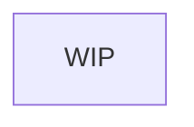

# AppTracker

A C#, Windows-based application that tracks software (and eventually browser/website) usage over time.

## Table of Contents
- [Architecture Overview](#architecture-overview)
- [0](#0)
- [1](#1)
- [2](#3)

---

## Architecture Overview


---

## XXXX System Example

some witty summary of the system listed


### Core Classes

#### `IInterfaceExample` (Interface)
**Pattern**: ...
**Functionality**: ...

#### `Example`
**Pattern**: ...
**Functionality**: ...

---

## XXXX System Example 2

some witty summary of the system listed


### Core Classes

#### `IinterfaceEx` (Interface)
**Pattern**: ...
**Functionality**: ...

#### `Example`
**Pattern**: ...
**Functionality**: ...

---

## Build Instructions

might not be needed? idk fully yet

### Prerequisites
- something
- something
- something

### Build Steps

#### 1.

#### 2.

#### 3.

### Testing
```bash
cd ___
./filename
```

---

## Project Structure
```
├── x/           # desc
│   └── xx  #desc
├── x/              # desc
│   └── xx  #desc
├── x/              # desc
│   ├── xx/       # desc
│   ├── xx  # desc
│   └── xx  # desc
├── x/            # desc
└── x/           # desc
    ├── xx/
    ├── xx/
    └── xx/
```

---

## Design Patterns Summary

| Pattern | Usage | Location |
|---------|-------|----------|
| **Adapter** | thing → adaptedthing | `.../thinglocation` |
| **Abstract Factory** | xxxx creation from files | `.../location` |
| **Composite** | Multiple factories | `.../location` |
| **Facade** | probably GUI | `.../location` |
| **Command** | sample commands | `.../location` |
| **MVC** | xxxx | `.../location` |
| **Observer** | some event notification | `.../location`, `.../location` |
| **Template Method** | some base class | `.../location` |
| **Strategy** | something | `.../location` |

---
